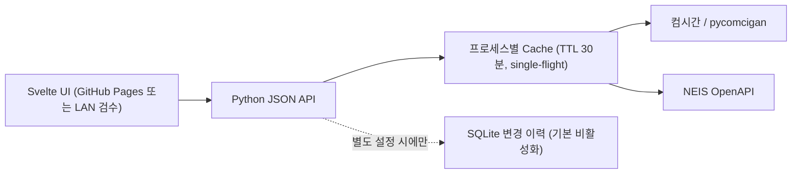

# 구조와 데이터 흐름

2026-11-14 저장소의 구현을 기준으로 합니다. 이 문서는 **현재 사용되는 Python/RPi 경로**와 **과거 Cloudflare Worker 실험**을 구분합니다.

## 구성

| 경로 | 주요 파일 | 역할 |
| --- | --- | --- |
| 프런트엔드 | `frontend/src/App.svelte`, `frontend/src/api.ts` | 학교·학급 선택, 시간표 모드 4종, 급식과 변경 이력 UI |
| HTTP API | `backend/app.py` | 쿼리 검증, 오류/CORS/요청 제한, `/api/v1` 라우팅 |
| 캐시 | `backend/cache.py` | 학교·검색어·기간 키, 실패 시 오래된 값 및 backoff |
| 컴시간 | `backend/timetable.py` | 학교 검색, 서비스 프로토콜 5분 재사용, 시간표 파싱 |
| 급식 | `backend/neis.py` | NEIS 학교 검색과 식단 가져오기 |
| 이력 | `backend/history.py` | 관측된 시간표 스냅샷 비교/SQLite/페이지네이션 |
| RPi API | `deploy/opensigan.service` | 로컬호스트 `127.0.0.1:8000` |
| LAN 검수 | `deploy/lan_preview.py`, `deploy/opensigan-preview.service` | 정적 프런트엔드 + 내부망 API 프록시 역할 |
| 과거 실험 | `workers-api/` | 독립적인 Cloudflare Workers/D1 구현 및 실험 기록 |

## 시간표 흐름

1. 사용자가 학교를 선택하면 컴시간 학교 ID(예: `1234:예시학교`)가 브라우저 로컬 저장소에 저장됩니다.
2. 프런트엔드는 `/api/v1/timetable?school=...&week=...`로 **학교 전체의 주간** 시간표를 가져옵니다.
3. 서버는 이번 주 또는 다음 주 월요일인지 검증하고 `(school, week)` 키로 캐시를 검사합니다.
4. 캐시 MISS 시 컴시간에서 받아 온 레코드를 정규화합니다. 동일 키의 중복 갱신은 프로세스 내에서 병합됩니다.
5. 브라우저는 받은 레코드를 학년·반·교사·날짜별로 재구성합니다. 따라서 각 화면 전환마다 학교 전체 시간표를 다시 조회하지 않습니다.

`cacheStatus`는 시간표 엔드포인트에서만 사용하며 `hit`/`miss`/`stale` 중 하나입니다. `stale` 플래그가 참이면 과거 캐시 결과일 수 있습니다. 실제 외부 응답 시간에는 원본 대기 외에도 네트워크 경로·브라우저 렌더링이 포함됩니다.

## 급식 흐름

컴시간 학교 ID와 NEIS 학교 ID는 별개입니다. 학교명과 지역 정보를 비교해 NEIS 학교를 매칭하며, 동명이교 등 확정할 수 없는 경우 사용자가 주소를 확인해야 합니다. 급식 응답은 NEIS 학교 ID 및 최대 7일의 기간으로 캐시합니다. **NEIS 키는 백엔드 환경 변수에서만 읽습니다.**

## 변경 이력의 의미

- 시간표 응답의 `isChanged`는 원본 제공자가 표시한 변경 정보입니다.
- `/api/v1/timetable/history`는 **이 시스템이 최초 수집한 시점 이후** 서로 다른 스냅샷 간 차이를 기록합니다. 처음 수집한 데이터는 기준점이므로 이력 항목이 아닙니다.
- 이력 저장은 `OPENCIGAN_HISTORY_DB` 미설정 시 꺼집니다. 켠 경우 최근 30일의 관측 차이를 조회할 수 있지만 모든 원본 변경이 빠짐없이 기록되었다고 보장하지 않습니다.

## 배포 경계

정적 사이트가 배포됐다는 사실은 API가 외부에서 열렸다는 뜻이 아닙니다. RPi 서비스는 로컬호스트에서 실행하고, LAN 검수는 별도의 내부망 경로를 사용합니다. **공개 터널은 별도 승인·검증 없이 열지 않습니다.** 프로세스별 캐시/요청 제한은 분산 환경에서 전역 제한이 아닙니다.

[운영 절차](operations.md) · [API 가이드](api-guide.md) · [성능 계측](latency-2026-11-13.md)
