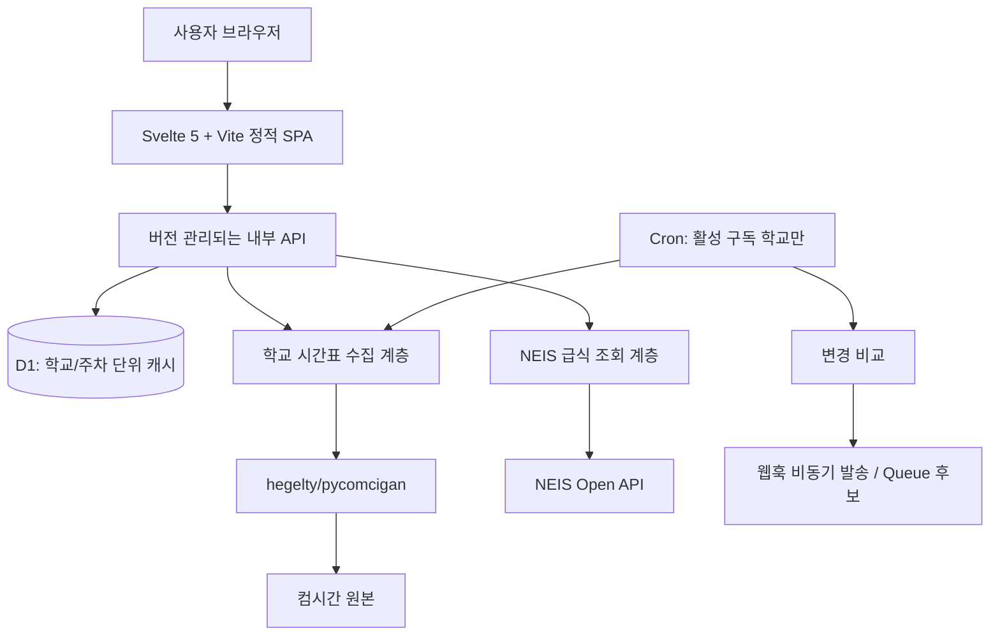

# 학교 시간표·급식 웹서비스 개발 계획서 (초안 v0.1)

- 작성 기준: 2026-11-10 (KST)
- 단계: 기획 완료 전 / 로컬 구현 착수 전
- 역할: 기획·설계 검토는 ChatGPT, 코드 작성·실행·배포는 사용자와 로컬 개발 에이전트
- 원칙: **최소 기술부채·최소 수동 운영·명확한 장애 감지**. 기술 스택의 경량화는 이 원칙보다 후순위.

## 1. 프로젝트 목표

학교를 검색하고 학년·반별 최신 시간표를 빠르게 볼 수 있는 반응형 웹서비스를 구축한다. 급식은 NEIS 공식 Open API를 통해 조회한다. 교사·학교 전체 시간표 및 웹훅 기반 변경 알림은 동일 데이터 모델을 바탕으로 단계적으로 지원한다.

기능 면에서는 사용자가 제공한 기존 시간표 사이트의 저장 HTML을 참고하지만 UI·소스 코드를 복제하지 않는다. 개인용 알림 서비스 `timetable-watcher`의 운영·데이터·배포에는 영향을 주지 않는다.

### 결정 사항 / 미결 사항

| 구분 | 내용 | 상태 |
|---|---|---|
| 디자인 | `Transient-Onlooker/monochrome-ui` 스킬 준수, 다크 기본·라이트 수동 선택 | 확정 |
| 변경 표시 | 현재 시간표만 표시. 변경된 교시에 `변동` 표시/구분선. 변경 전 과목 표시 없음 | 확정 |
| 프런트엔드 | Svelte 5 + Vite + TypeScript, 자체 CSS 우선 | 잠정 |
| 파서 | `hegelty/pycomcigan`을 기준 구현으로 사용. 프로토콜 로직 중복 작성 지양 | 확정 |
| 백엔드 | Cloudflare Python Workers 우선 검증, D1 캐시 후보 | 실증 필요 |
| 급식 | NEIS 공식 Open API, 서버 측 API 키 보관 | 방향 확정 |
| 서비스 규모 | 전국 학교를 지향하되 베타 범위는 검증 후 확정 | 미결 |
| 학생·교사·전체 화면 | 학생 중심 MVP, 교사·전체 조회의 1차 포함 여부 결정 필요 | 미결 |
| 모바일 | 주간 표/일간 목록/전환 중 사용성 검토 후 결정 | 미결 |
| 로그인 | 조회 무계정 선호. 웹훅 인증·관리 방식 미결 | 미결 |
| 주기 | 일반 캐시 약 30분, 구독 학교 약 1시간은 초기 **가설** | 미결 |

## 2. 기술 구조 (목표안, 확정 아님)

**원칙**: UI는 컴시간의 원본 필드명·암호화 방식·통신 규약을 몰라야 한다. 외부 데이터 구조 변경은 수집 계층과 파서에서만 대응하며, 브라우저에는 정규화된 안정적 JSON 계약만 제공한다. `timetable-watcher`는 독립적으로 유지한다.

### Python Workers 실행 결정 게이트

Cloudflare Python Workers는 GA 상태이며 `pywrangler`를 지원한다. 하지만 `pycomcigan`을 해당 런타임에서 **수정 없이** 실행할 수 있는지는 검증되지 않았다. 무료 Workers의 HTTP 요청 CPU 사용 한도는 10ms이다. 코드/패키지 호환성, `comci.net:4082` 연결, 복호화·HMAC·JSON 파싱의 CPU 비용, 콜드스타트 및 실패 동작을 **로컬+실제 Workers 환경에서** 검증한다.

1. **통과**: Python Workers + `pycomcigan`을 사용하되, 성능에 필요한 제한된 호환 어댑터만 적용한다. 원본 라이브러리 변경 필요 시 upstream에 제안하고 분기 최소화.
2. **호환은 되나 CPU 한도 초과**: WebCrypto 호출 또는 유사한 경계 최적화를 *검증 후* 검토. 기존 파서 전체를 TS로 재작성하지 않는다.
3. **실용성 미달**: 관리형 CPython 백엔드에서 `pycomcigan`을 실행하고 Cloudflare는 정적 사이트/API 게이트웨이·캐시를 담당한다. 이 경우 서비스 수 증가에 따른 유지보수 비용을 비교한다.

> `pycomcigan`의 순수 Python AES와 `pycryptodomex`의 속도 차이는 기존 서버 에이전트의 측정 결과다. WebAssembly/Pyodide 환경으로 성능 수치를 직접 외삽하지 않는다. 기존 코드는 벤치마크나 포팅을 이유로 임의 변경하지 않는다.

## 3. 사용자 화면과 기능

### 공통
- 최초 방문: 학교 검색 및 선택, 학년·반 선택. 이후 브라우저에서 마지막 선택 복원(개인 계정 불필요).
- 시간표: 월~금, 교시별 과목·교사(데이터가 있는 경우). 현재 주와 다음 주 전환.
- 변경 표시: 현재 교시 정보만 보여주고 `변동` 레이블·단색 구분선으로 구별. 변경 전 수업 정보는 화면에 노출하지 않음.
- 조회 신선도: 원본 갱신 시각과 **우리 서버의 마지막 정상 수집 시각**을 구별해서 표시. 실패 시 오래된 캐시임을 명시.
- 급식: NEIS 식단, 급식일·유형(조/중/석식, 제공되는 경우), 알레르기 정보. 시간표와 급식 실패는 독립 처리.
- 설정: 다크(기본)/라이트 전환. 디자인 설정 토글 남발 금지. 마지막 학교·학급·테마는 로컬 저장.
- 접근성: 키보드 이동, `focus-visible`, 충분한 대비, 로딩·빈 데이터·오류 상태. 최소 320px 폭에서 기능 확인.

### MVP 우선순위
- **P1 필수**: 학교 검색, 학생용 학급 시간표, 주차 전환, 현재 상태의 변경 표시, 급식 조회, 다크/라이트, 오류/캐시 표시.
- **P2 협의**: 교사 시간표, 전체 학년/반 시간표, 링크 공유, 이미지 저장, PWA. 데이터/사용성 확인 후 결정.
- **P3 후속**: 사용자별 웹훅 등록·관리, 구독 학교 주기 갱신, 재시도, Discord 등 대상별 전송.

## 4. 내부 API 및 데이터 모델 (계약 초안)

> 경로/필드명은 로컬 에이전트와 함께 확정. 특정 외부 포맷을 API 계약으로 그대로 노출하지 않는다.

| 용도 | 계약 초안 | 비고 |
|---|---|---|
| 학교 검색 | `GET /api/v1/schools?q=...` | 중복 학교명 구분, 컴시간 코드 및 NEIS 식별자 별도 매핑 |
| 학생 시간표 | `GET /api/v1/timetable?school=...&week=...` | 한 번의 조회/캐시에 학교 전체 주간 데이터 저장; 응답 노출 범위는 필요 최소화 |
| 급식 | `GET /api/v1/meals?school=...&from=...&to=...` | NEIS 인증키 서버 비밀값; 시간표 수집과 독립 |
| 상태 | `GET /api/v1/status` | 원본 장애, 데이터 신선도, 공지 등 사용자에게 필요한 수준 |
| 웹훅(후속) | `POST /api/v1/subscriptions` 등 | 인증·권한·발송 정책 확정 전 외부 공개 금지 |

시간표의 정규화된 레코드는 최소한 `schoolId`, `weekStart`, `grade`, `class`, `date`, `period`, `subject`, `teacher`, `isChanged`, `sourceUpdatedAt`, `fetchedAt`를 구분한다. `isChanged`는 **컴시간 원본의 변경 표시/원본-현재 차이**이고, `fetchedAt`은 서비스가 수집한 시각이다. 서로 혼동하지 않는다. 교사명은 출처가 제공하는 범위·마스킹을 존중한다.

**식별자 주의:** 컴시간 학교 코드와 NEIS의 `ATPT_OFCDC_SC_CODE`/`SD_SCHUL_CODE`는 서로 다른 체계다. 학교명 문자열 매칭만으로 확정하지 않고, 중복·개명·동명이교를 처리하는 매핑 절차를 둔다.

## 5. 캐시·변경 감지·부하 제한

- 캐시 키는 `(학교 식별자, 해당 주 시작일)` 중심. 원본에서 학교 전체 시간표를 받는 특성을 활용해 학급마다 중복 호출하지 않는다.
- 데이터 TTL 초안 30분. 사용자가 찾지 않는 학교는 지속적으로 폴링하지 않음. 만료 시 이전 정상 응답을 제공하고 비동기 갱신 가능하게 설계.
- 동일 학교·주차에 대한 동시 재검증은 **단일 비행(single-flight) 또는 분산 잠금**으로 병합. 다중 Workers 인스턴스에서도 중복 요청을 막을 방법을 설계.
- `/st`의 회전하는 필드/프로토콜 설정은 별도 캐싱하고, 형식 오류 때만 제한적으로 재조회. 무한 재시도 금지.
- 기존 에이전트 보고: 전체 조회 평균 2.56초(3요청) vs 초기화 캐시 후 1.15초(1요청). 갱신 시각 필드는 응답 *수신 후*에만 확인할 수 있어 경량 조건부 조회 수단이 아님.
- 원본 요청에 전역 속도 제한, 403/429 백오프, 타임아웃, 실패 횟수 상한, 데이터 손상 시 캐시 보존 정책을 둔다.
- 새 데이터의 시각만 달라졌는지, 실제 교시 내용이 달라졌는지 별도로 비교한다. 알림 이벤트는 새 기준선 이후의 실질 변화에 대해서만 생성한다.

## 6. 웹훅·개인정보·안전 (후속 개발 전 결정)

- 계정 없는 조회를 기본 후보로 유지하되, **무계정 ≠ 개인정보 처리 의무 면제**임을 전제한다.
- 구독 관리 방식은 `무작위 관리 토큰`과 `OAuth 로그인` 중 결정. 토큰 방식이라면 충분한 엔트로피, 해시 저장, 폐기·회전·복구 정책 필요.
- 범용 웹훅 URL은 등록 시와 발송 시 모두 SSRF 방어(사설/루프백/메타데이터 IP, 리다이렉트 검증), HTTPS 강제, 사용자·학교별 할당량 적용.
- 수신자는 HMAC 서명·이벤트 ID·재전송 구분 가능. Discord처럼 별도 포맷이 필요한 대상은 독립 어댑터 사용.
- 웹훅 URL과 시크릿은 로그에 남기지 않으며 저장 시 보호 방식을 정의. 구독 종료 시 데이터 삭제 기준 마련.
- 공개 전 개인정보처리방침, 접근 로그 보존, 제3자 서비스 전송, NEIS 이용 조건, 컴시간 원본 데이터의 이용허락 범위를 검토한다. 비공식 API에 접근 가능하다는 사실만으로 재배포 권한이 확보되는 것은 아니다.

## 7. 기술부채 통제 규칙

1. 컴시간 프로토콜 로직은 `hegelty/pycomcigan` 중심으로 유지하고, 복제·재구현보다 upstream 버전 고정 및 업데이트 전략을 우선한다.
2. 프런트엔드는 Svelte의 공식 기능만으로 시작. 전역 상태 라이브러리, 컴포넌트 라이브러리, 별도 CSS 프레임워크는 문제가 확인될 때만 도입.
3. 모듈 경계는 `source-adapter`, `normalized-model`, `cache`, `api`, `ui`, `notification`으로 구분하되 과도한 추상화는 피한다.
4. 패키지와 Cloudflare 런타임 호환 날짜를 명시적으로 고정하고, 자동 검증 없이 메이저 버전을 올리지 않는다.
5. 원본 데이터가 변해도 UI 데이터 계약을 가급적 유지한다. 계약 파괴 시 API 버전 갱신.
6. CI에서 타입 검사, 빌드, 단위·통합 테스트, `monochrome-ui` 접근성·반응형 체크를 자동 실행.
7. 원본 장애는 경보/관찰 가능하게 만들되, 사용자에게는 과도한 내부 정보를 노출하지 않는다.
8. 기존 `timetable-watcher`는 수정하지 않으며, 필요한 로직은 외부 동작·테스트 기준으로만 참조한다.

## 8. 단계별 개발 범위·완료 기준

### Phase 0 — 타당성 확인 (첫 구현 작업)
- Cloudflare Python Workers에서 upstream `pycomcigan` 의존성·시작 시간·실조회 가능 여부 검증.
- `:4082` 연결·403/429·원본 타임아웃, 학생 시간표 파싱·교시 변경 표시 동일성 확인.
- 무료 Workers CPU·메모리·실제 네트워크 왕복 시간 측정. 배포 환경을 전제로 한 반복 측정 결과 기록.
- 통과/실패 판정과 대체 백엔드 선택을 짧은 ADR(설계 결정 기록)로 남김.
- 원본 요청 횟수 최소화; 실패 시 무제한 반복 요청 금지.

### Phase 1 — 로컬 UI MVP
- Svelte 5 + Vite + TypeScript 프로젝트와 `monochrome-ui` 규칙 적용.
- 정규화한 테스트 데이터로 학교 검색·주간 학생 시간표·변경 레이블·테마 구현.
- NEIS 공식 API 연동과 학교 코드 매핑 설계. 키를 브라우저 번들에 포함하지 않음.
- 모바일 320/390/800px, 데스크톱 1366px 체크; 키보드·빈 데이터·오류·로딩 검증.

### Phase 2 — 캐시 및 실제 조회
- Workers API, D1 저장, 최초 조회/TTL/동시 조회 병합, 신선도 표시.
- 원본 장애 시 기존 캐시 제공 및 오류 로그·알림 체계.
- 학교 중복 검색과 주차 경계·다음 주 부재·공휴일·학기 말 엣지케이스 테스트.

### Phase 3 — 공개 베타
- 사용 범위·요청 제한·개인정보처리방침·외부 데이터 이용조건 점검.
- 사용자 행동 관찰 및 캐시 정책 검증. 운영자 수동 개입이 필요한 장애 유형을 문서화.
- 웹훅/교사/전체 화면의 우선순위를 실사용 피드백과 유지보수 비용에 따라 결정.

### Phase 4 — 웹훅(선택)
- 구독/인증/해지, 활성 학교만 주기 확인, 스냅샷 차이, HMAC 전송 및 중복 방지.
- 실패 재시도 한도·백오프·만료, SSRF·시크릿 보호·이벤트 수신 테스트.

## 9. 첫 구현을 시작하기 전에 남은 의사결정

1. 전국 학교 공개 베타인가, 제한된 학교/사용자 베타인가?
2. MVP에 교사용·전체 시간표도 포함할까, 학생용부터 출시할까?
3. 모바일은 주간 전체 표 우선인가, 일간 모드도 제공할까?
4. 웹훅 개발을 1차 출시에 포함할까, 별도 Phase 4로 둘까?
5. 무계정 웹훅 관리 토큰인가, OAuth 로그인인가?
6. Cloudflare Python Workers 실측 실패 시 유료 Workers vs 관리형 CPython 중 무엇을 우선할까?
7. 컴시간 원본 데이터의 공개 재제공·이용허락 문제를 어떤 방식으로 확인할까?

## 10. 로컬 에이전트 인계 원칙

- 이 문서는 **설계 초안**이며 최종 확정되지 않은 항목을 임의로 결정하지 않는다.
- **첫 작업은 Phase 0 호환성 스파이크와 검증 보고서**다. 처음부터 전체 기능 구현·공개 배포를 진행하지 않는다.
- 코드 수정에 착수할 때는 새 프로젝트 저장소를 사용하고 기존 `timetable-watcher`, upstream `pycomcigan`을 수정하지 않는다.
- 모든 변경은 테스트 결과, 환경, 재현 절차, 미검증 사항, 잔여 장애 위험을 함께 기록한다.
- 테스트 시 네트워크 요청 최소화 및 민감정보 비공개. 계정·토큰·학교 개인 데이터·대량 원본 응답을 저장소에 커밋하지 않는다.

## 참고 출처 (확인일: 2026-11-10)

- `pycomcigan`: https://github.com/hegelty/pycomcigan
- 기존 감시기: https://github.com/Transient-Onlooker/timetable-watcher
- UI 스킬: https://github.com/Transient-Onlooker/monochrome-ui
- Cloudflare Python Workers: https://developers.cloudflare.com/workers/languages/python/
- Python Workers 패키지: https://developers.cloudflare.com/workers/languages/python/packages/
- Workers 한도: https://developers.cloudflare.com/workers/platform/limits/
- Workers 정적 에셋: https://developers.cloudflare.com/workers/static-assets/
- Workers 포트 지원: https://developers.cloudflare.com/workers/configuration/compatibility-flags/
- NEIS API 개발자 가이드: https://open.neis.go.kr/portal/guide/apiGuidePage.do
- NEIS 급식 OpenAPI: https://www.data.go.kr/data/15139198/openapi.do
